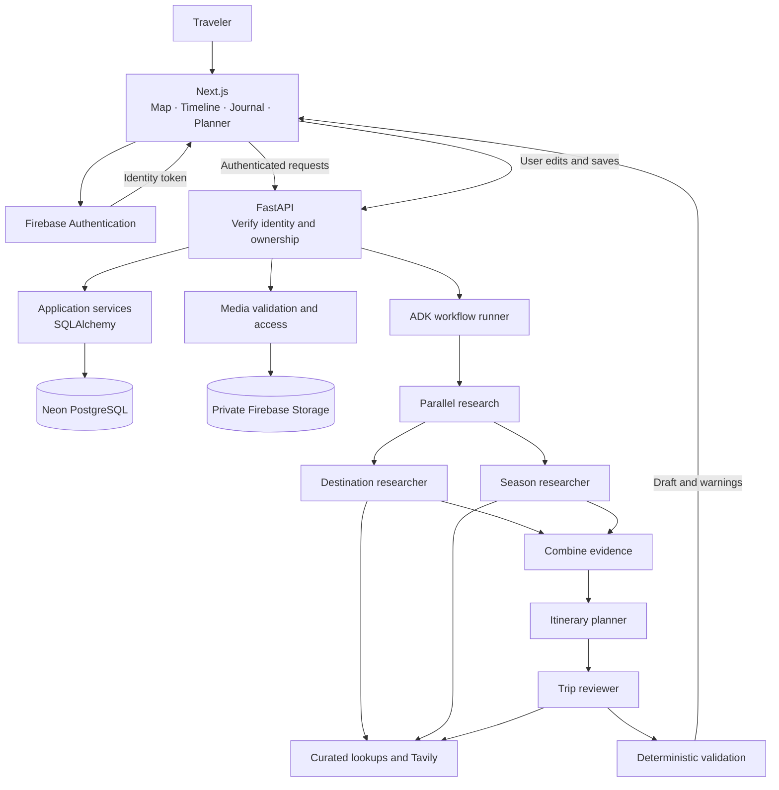
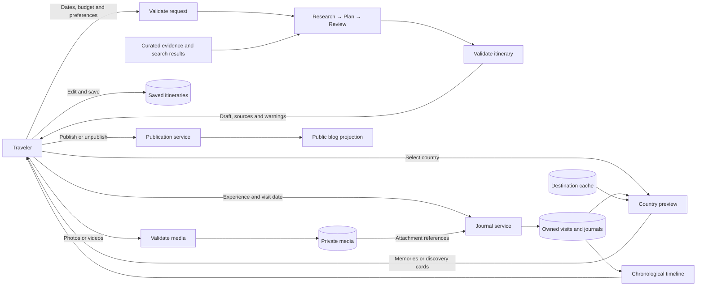
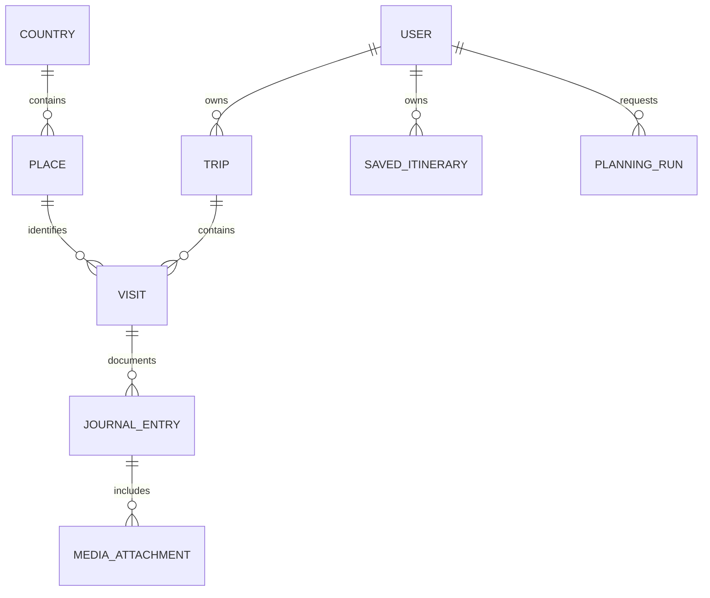

# Travelogue

> An illustrated travel timeline and world map for preserving memories, discovering destinations, and planning trips through coordinated AI agents.

**Status: design-stage workshop prototype.** This README describes the agreed implementation target. Application code, setup scripts, integrations, and measured evaluation results are not yet available. Commands marked as planned must be implemented and verified before release.

---

## Overview

### Problem Statement & Intended Users

- **Problem:** Travel memories, photos, destination research, and itineraries are scattered across disconnected applications. Travelogue brings them together through geography and chronological storytelling.
- **Intended users:** Travelers documenting journeys and planning trips, and developers exploring an open-source multi-agent application.

**Hosted-app users need only a browser.** They do not install PostgreSQL, Firebase, Python, or agent tools, and do not provide API keys. Local installation requirements apply to developers only.

### Key Features

1. **World map:** Distinguish visited and unvisited countries and mark recorded places.
2. **Destination discovery:** Preview attraction thumbnails and recommended visiting months for unvisited countries.
3. **Multimedia journal:** Record visited places, dates, and experiences with photos and short videos.
4. **Geographic memories:** Preview previously visited places and open their associated blog entries.
5. **Travel planner:** Generate editable daily itineraries from dates, budget, interests, and travel preferences through coordinated agents.
6. **Illustrated timeline:** Organize memories by year, trip, day, and place.

Entries start private. Users explicitly publish or unpublish individual posts. Recording a visit marks its country visited even without a blog; only entries with blog content provide blog links.

The interface uses midnight navy surfaces, ivory text, teal visited countries, slate unvisited countries, and amber planned-trip badges. Labels and icons accompany colors. Illustrations include passport stamps, postcard imagery, and route lines. Desktop combines the timeline with a sticky map; mobile offers Map/Timeline tabs. Hover previews also work through keyboard selection and mobile taps. Respect reduced-motion preferences.

---

## Technical Stack

| Component | Planned technology |
| :--- | :--- |
| Language and runtime | TypeScript, Node.js 22; Python 3.11 |
| Frontend | Next.js |
| Styling and animation | Tailwind CSS, shadcn/ui, Motion for React |
| Map | MapLibre GL JS and bundled Natural Earth country boundaries |
| Backend | FastAPI, Pydantic |
| Agent framework | Google Agent Development Kit (ADK) |
| Models | Gemini; explicit model identifier configured through an environment variable |
| Authentication | Firebase Authentication |
| Relational database | Neon PostgreSQL |
| Database access and migrations | SQLAlchemy, Alembic |
| Media storage | Cloud Storage for Firebase |
| Research | Tavily |
| Video inspection | FFprobe |
| Local demo | SQLite, local media, scripted agent outputs |

Keep code, manifests, lockfiles, migrations, configuration examples, fixtures, and documentation inside `agents/travelogue/`. Do not add dependencies to the repository root.

---

## Architecture & Data Flow

### Application Architecture



Map browsing, journaling, and timeline rendering use ordinary application services. Agents handle research and itinerary generation. The browser never connects directly to Neon: personal database operations pass through ownership-checked backend services.

### Agent Responsibilities

| Agent | Responsibility | Output |
| :--- | :--- | :--- |
| Destination researcher | Find attractions matching interests and constraints | Places, evidence references, coordinates and visit durations where available |
| Season researcher | Assess regional visiting periods for the requested dates | Seasonal guidance, sources, tradeoffs, and uncertainty |
| Itinerary planner | Combine preferences and evidence | Daily activities, travel buffers, and estimated costs |
| Trip reviewer | Review grounding, constraints, and feasibility | One revised draft and unresolved warnings |

Researchers run in parallel and write separate state keys. Planning and review follow sequentially. Deterministic validation checks required fields, dates, country consistency, duration, and budget arithmetic. Structural validity does not establish factual accuracy.

Bound each run to one country, up to 14 days, eight search calls, four model turns per agent, one reviewer revision, and a 120-second deadline. No recursive delegation. Incomplete runs return explicit warnings or failure status. Agents cannot book trips, publish entries, or execute arbitrary commands.

### Data Flow



Country previews use cached records. Hovering never starts model work. Missing or refreshed destination information requires an explicit research action. Store source URLs and retrieval timestamps; prefer official tourism and attraction sources. Missing facts stay unknown. Prices and travel buffers remain estimates unless supported by evidence.

### Relational Data Model



PostgreSQL holds relationships, journal content, attachment references, research metadata, and saved plans. Media files remain in file storage. Owned records reference the verified Firebase UID.

### Interfaces and Internal Tools

Application services provide country summaries and cached previews, explicit research requests, owner-scoped planning-run progress/results, CRUD for visits/journals/attachments/saved plans, and explicit publication with public reads of published entries.

| Tool | Purpose |
| :--- | :--- |
| `lookup_destinations` | Curated attractions, coordinates, and image attribution |
| `lookup_seasons` | Regional visiting windows and seasonal notes |
| `search_travel_sources` | Tavily source URLs, excerpts, and timestamps |
| `validate_itinerary` | Structural and arithmetic checks |

These tools live inside Travelogue. No separate root `tools/` contribution or MCP server is required for v1.

---

## Prerequisites

### Hosted-App Users

- Modern browser.
- Sign-in for saving journals and itineraries or uploading media.

### Local Developers

- Git, Node.js 22, and npm.
- Python 3.11 and pip.
- FFprobe for video inspection.

The standard demo requires no API keys, Docker, Firebase emulator, or local PostgreSQL installation.

### Live Integration Operators

- Firebase project with Google sign-in and private Storage configured.
- Neon PostgreSQL database.
- Gemini API access and an available model identifier.
- Tavily API key.

Service quotas apply independently. Hosting, media, search, and model usage may incur charges.

---

## Installation & Setup

**Planned commands, not implemented or verified.**

1. Navigate to the project:

   ```bash
   cd agents/travelogue
   ```

2. Initialize the demo:

   ```bash
   npm run setup
   ```

   The script will create a Python virtual environment, install declared dependencies, create configuration from placeholders without overwriting existing values, apply demo migrations, and seed sample data.

3. For live mode, configure the external services and apply PostgreSQL migrations with the documented project command.

Before release, supply project-local manifests, lockfiles, `.gitignore`, and `.env.example`, and replace planned setup with verified instructions for platforms actually tested. This documentation-only draft does not include application scaffolding.

---

## Configuration & Environment Variables

| Variable Name | Required | Default | Description |
| :--- | :--- | :--- | :--- |
| `TRAVELOGUE_MODE` | No | `demo` | `demo` or `live` |
| `DATABASE_URL` | Live | Local SQLite in demo | Server-side Neon PostgreSQL connection |
| `GEMINI_API_KEY` | Live | None | Server-side model credential |
| `GEMINI_MODEL` | Live | None | Explicit model identifier |
| `TAVILY_API_KEY` | Live | None | Server-side search credential |
| `FIREBASE_PROJECT_ID` | Live | None | Backend Firebase project |
| `FIREBASE_STORAGE_BUCKET` | Live | None | Private media bucket |
| `GOOGLE_APPLICATION_CREDENTIALS` | Local live development | None | Local credential-file path; prefer workload identity when hosted |
| `NEXT_PUBLIC_FIREBASE_API_KEY` | Live | None | Browser Firebase configuration |
| `NEXT_PUBLIC_FIREBASE_AUTH_DOMAIN` | Live | None | Browser authentication domain |
| `NEXT_PUBLIC_FIREBASE_PROJECT_ID` | Live | None | Browser Firebase project |
| `NEXT_PUBLIC_API_BASE_URL` | No | Local backend | API endpoint |
| `LOG_LEVEL` | No | `info` | Backend logging verbosity |

Backend configuration loads from the project-root `.env`. Frontend setup exposes browser configuration explicitly. Never place privileged credentials or database passwords in `NEXT_PUBLIC_*` variables. Firebase browser configuration does not replace authorization checks.

---

## How to Run

**Planned command, not implemented:**

```bash
npm run dev
```

This will start the frontend and backend together.

- **Demo:** sample traveler, SQLite, local media, and scripted results; persistent **“Demo: scripted data”** label; no live agent execution. Bind the backend to loopback. Public sharing is unsupported.
- **Live:** Firebase sign-in, Neon persistence, private Firebase Storage, Gemini/Tavily research, ownership checks, and explicit blog publication.

Add hosted deployment instructions and a URL after verification. A hosted demonstration must isolate visitors' writes rather than expose one shared writable account.

---

## Example Input & Output

### Example Input

```text
Plan five days in Japan in November for two adults,
starting in Kyoto.

Interests: temples and local food.
Pace: relaxed.
Budget: INR 120,000, excluding international flights.
```

The structured request must supply exact dates and the year before generation.

### Example Output

**Not yet captured.** There is no genuine application run at this stage.

After implementation, include separately labeled demo and live results with daily activities, sources, cost estimates, seasonal guidance, assumptions, and warnings. Never represent illustrative or scripted output as a live result.

---

## How to Test

**Planned command, not implemented:**

```bash
npm run verify
```

Run backend tests, frontend lint/type checks, browser tests, and a production build. Invoke live evaluations separately to avoid unexpected API usage and costs.

### Functional Completeness and Correctness

| Feature | Completeness | Correctness |
| :--- | :--- | :--- |
| Map | All countries in the selected dataset are selectable | Visit status and markers match records |
| Discovery | Place, image or labeled fallback, months, and sources are present | Country association, guidance, and attribution are accurate |
| Journal | Create, edit, delete, retrieve, and attach supported media | Content persists accurately; upload failures leave no broken references |
| Memories | Recorded places and applicable blog links appear | Links open the correct entry; private content stays protected |
| Planner | All requested days and deliverables are covered | Dates, geography, cost arithmetic, sequence, and constraints are consistent |

Also test empty states, keyboard/touch/mobile access, hover-card interaction, reduced motion, publication/unpublication, invalid media, and API/media access between two different users.

### Planner Evaluation Rubric

| Dimension | Weight | Evaluation |
| :--- | ---: | :--- |
| Completeness | 25% | All days, fields, and deliverables |
| Constraint adherence | 25% | Country, dates, traveler count, budget, pace, and explicit preferences |
| Factual grounding | 25% | Sources genuinely support associated claims |
| Practical feasibility | 15% | Plausible daily schedules and travel sequences |
| Clarity and uncertainty | 10% | Visible estimates, assumptions, missing evidence, and concerns |

**Proposed gate:** at least 85/100 overall and 80% per dimension. Report individual cases and suite pass rates so averages cannot hide failures. Invalid/infeasible cases should elicit clarification or an explained inability to satisfy constraints, not fabricated plans.

Mandatory checks for successful outputs:

- Valid response schema and complete, nonduplicated dates.
- Consistent currency, traveler count, and budget arithmetic.
- Activities reference curated or sourced places.
- External claims have supporting evidence or explicit unverified labels.
- No fabricated citations; citation presence alone is insufficient.
- Execution respects limits; research failures produce warnings or failed status.
- Private content remains inaccessible to unauthorized users.

Privacy failures and fabricated citations block release regardless of score. Combine deterministic checks, evidence fixtures, and independent human review. An optional LLM judge is supplementary; the reviewer agent cannot certify itself.

### Evaluation Dataset and Baseline

| Category | Cases |
| :--- | ---: |
| Standard trips: two per seeded country | 10 |
| Preference-heavy trips | 5 |
| Difficult/conflicting constraints | 5 |
| Invalid or missing inputs | 5 |
| Failures and adversarial inputs | 5 |

Version these 30 cases with inputs, expected behavior, constraints, and evidence fixtures. Cover dietary/accessibility preferences, unrealistic budgets, reversed dates, search outages, malformed responses, conflicting evidence, retrieved prompt injection, and timeouts. Do not require one exact itinerary.

Run deterministic regressions on changes. Before release, run the live suite three times and report variability. Compare against a single-agent baseline using the same model, inputs, tools, and total resource limits. Measure quality, unsupported-claim rate, constraint violations, latency, token usage, and cost.

### Evaluation Results

| Measure | Status |
| :--- | :--- |
| Functional acceptance | Not evaluated |
| Completeness and constraint adherence | Not evaluated |
| Factual grounding and feasibility | Not evaluated |
| Privacy and ownership | Not evaluated |
| Multi-agent versus single-agent comparison | Not evaluated |
| Fresh installation | Not verified |

Report dataset version, model identifier, date, environment, and limitations alongside measured results. Do not claim gates passed before execution.

---

## Known Limitations

- Seeded discovery: India, Japan, Italy, France, Thailand. Other countries show empty states until explicitly researched in live mode.
- One country and up to 14 days per itinerary.
- Seasonal patterns are not weather forecasts.
- Costs and travel buffers are estimates unless supported by evidence; no routing provider in v1.
- No bookings, payments, or live availability.
- Images: JPEG/PNG/WebP, up to 10 MB. Videos: MP4/WebM, up to 25 MB and 30 seconds. No transcoding.
- Free tiers have quotas and do not make the whole application free.
- SQLite tests do not establish PostgreSQL compatibility; verify live migrations and queries separately.
- Platforms, model quality, latency, cost, and token consumption remain unverified.

---

## Security & Privacy Considerations

- **Authentication and ownership:** Verify Firebase tokens. Derive ownership from verified identity rather than client-supplied user IDs. Check every personal resource.
- **Database and secrets:** Backend-only Neon access. Keep credentials out of Git and browser bundles.
- **Media:** Private storage; server-side file-content, size, and duration validation. Authorize reads using entry ownership/publication state and stream through controlled access rather than permanent public download URLs.
- **Publication:** Explicit publish/unpublish actions. Previously downloaded public content cannot be recalled.
- **Content:** Validate API inputs and sanitize rendered journal content.
- **Data privacy:** Exclude private journals and media from prompts. Live planning sends preferences to Gemini and research queries to Tavily.
- **Agent safety:** Retrieved text is untrusted evidence. Agents cannot publish, book, pay, or execute arbitrary commands.
- **Logging:** Record stage, duration, tool counts, errors, and reported token usage without credentials, private entries, or full prompts.

---

## Future Improvements

- [ ] Multi-country itineraries.
- [ ] Verified routing and transport durations.
- [ ] Calendar and itinerary export.
- [ ] Optional journal drafting from user-provided notes.
- [ ] Media optimization and transcoding.
- [ ] Broader curated destination coverage.
- [ ] Offline reading.
- [ ] Expanded evaluation datasets and cost reporting.

---

## License

Contributed under the repository's [MIT license](../../LICENSE).

Preserve applicable attribution and licenses for third-party images, map data, and other assets. Curated thumbnails must have documented reuse rights.
